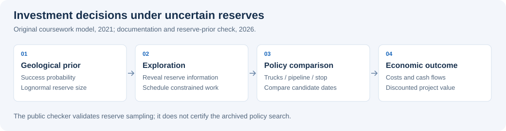

# Monte Carlo Decisions under Geological Uncertainty

**[Mathematical model](docs/model.md) · [Reproducible distribution check](scripts/reserve_audit.py) · [2021 source](MonteCarlo_solution_v2.2.py)**

**Simulation-based comparison of exploration, infrastructure investment and delivery decisions.**

This is my 2021 coursework on decisions under uncertain resource reserves. It combines geological success probabilities, lognormal reserve sizes, exploration and construction schedules, operating constraints and discounted cash flows. The alternatives are to keep delivering by truck, invest in a pipeline, or stop the project.

The original scripts are retained. The documentation and independent distribution check were added in 2026 to make the mathematical assumptions and source easier to inspect. They are not a new measured investment result.



## Mathematical structure

For prospect $i$, the intended prior model combines a probability of geological success with a positive reserve distribution:

$$
Q_i=I_i\exp(\mu_i+\sigma_i Z_i),\qquad
I_i\sim\mathrm{Bernoulli}(p_i),\quad Z_i\sim N(0,1).
$$

Assuming independent $I_i$ and $Z_i$, the expected reserve is

$$
\mathbb E[Q_i]=p_i\exp(\mu_i+\sigma_i^2/2).
$$

Simulated reserves feed a monthly exploration and construction timeline. The economic layer compares discounted cash flows under alternative delivery policies. The [model note](docs/model.md) maps each step to the original functions and distinguishes the intended model from inconsistencies in the archived implementation.

| Modelling component | Decision or quantity |
| --- | --- |
| Bernoulli-lognormal uncertainty | Whether a prospect succeeds and how much resource it contains |
| Sequential information | Reserves revealed by completed exploration |
| Resource constraints | Available exploration teams, construction delays and transport capacity |
| Cash-flow simulation | Revenue, capital expenditure, operating costs and discounting |
| Policy comparison | Continue trucks, construct a pipeline, or stop |

## Run the distribution check

Python 3.11 or 3.12:

```bash
python -m venv .venv
source .venv/bin/activate
python -m pip install -r requirements-checks.txt
python scripts/reserve_audit.py --draws 100000 --seed 12345
python -m unittest discover -s tests
```

This reads the ten prospects in the supplied workbook, simulates their prior reserves and compares sample means with analytic expectations. It writes a CSV to `outputs/reserve_audit.csv` and reports Monte Carlo standard errors. It **does not execute or validate the full legacy investment-policy search**.

The file named `Датасет.xlsx` is actually an OpenDocument spreadsheet. The checker detects its content and uses the correct reader while preserving the original file. Input parameters are taken from the workbook's `Геология` sheet.

## Explore the original work

| File | Purpose |
| --- | --- |
| [v2.2](MonteCarlo_solution_v2.2.py) | Main late coursework version: schedules, policy simulation and decision-date search |
| [Annotated v2.2](MonteCarlo_solution_v2.2_with_test_prints_and_algorithm.py) | Additional intermediate output and algorithm comments |
| [Model note](docs/model.md) | Equations, code map and interpretation of the decision rule |
| [Workbook](Датасет.xlsx) | Geological, exploration, infrastructure and economic inputs |

Earlier `v1.*`, `v2.0` and `v2.1` scripts preserve the development history. Calendar years 2022-2050 inside the model describe the simulated project horizon; they are not the coursework dates.

## Scope

This is an early mathematical modelling project with a heuristic policy search. The archived selection rule counts how often an action has the highest simulated NPV, which is different from maximising expected NPV. Some branches also sample unrevealed reserves differently. A validated financial-policy result would require resolving those issues, separating policy selection from evaluation, and quantifying simulation uncertainty. The current package makes the reserve model independently reproducible without claiming that validation is complete.
